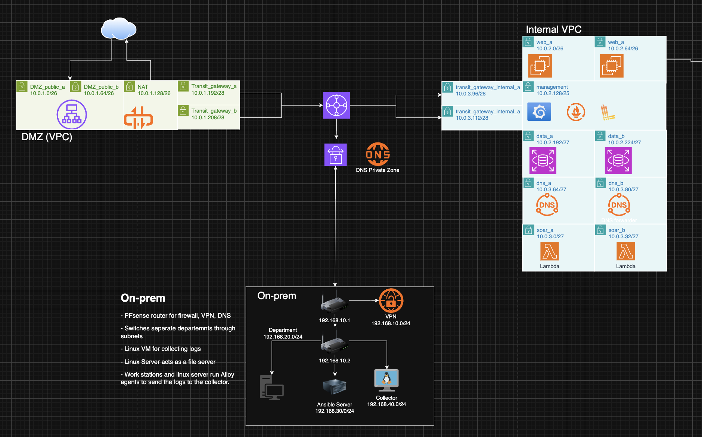
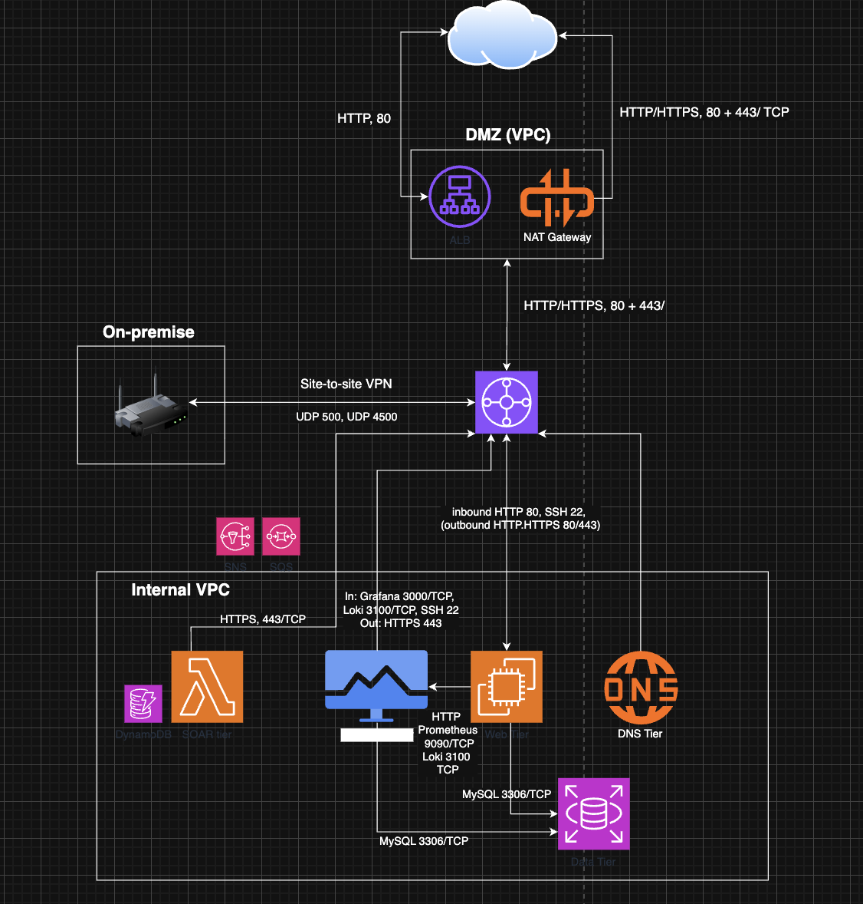
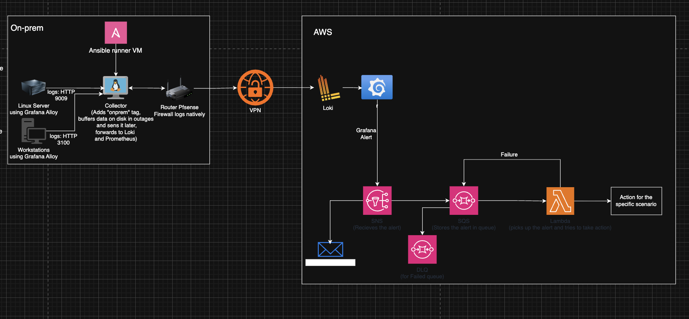

# Innovatech Hybrid Cloud with SOAR

## What is this project?

This project builds a hybrid cloud environment for the fictional company Innovatech, connecting an on-premises network (pfSense firewall with VLANs) to AWS over a site-to-site IPsec VPN. All AWS infrastructure is defined as code with Terraform, split into reusable modules for networking, web hosting, database, DNS, VPN, monitoring and security automation. A public web tier runs behind an Application Load Balancer in a DMZ VPC, while web servers, a MySQL database and the monitoring stack live in a separate private internal VPC. Logs and metrics from on-prem machines and the firewall are collected with Grafana Alloy (deployed with Ansible) and shipped to Loki, Prometheus and Grafana in AWS. On top of that, a small SOAR pipeline detects SSH brute-force attacks and automatically blocks the attacker's IP on the pfSense firewall.

## Tech stack

- **Cloud** - AWS (eu-central-1)
- **Infrastructure as Code** - Terraform
- **Configuration management** - Ansible
- **Networking** - Amazon VPC, Transit Gateway, NAT Gateway, Site-to-Site IPsec VPN, Route 53 private hosted zone
- **On-prem firewall** - pfSense (IPsec, VLANs, REST API)
- **Compute & web** - EC2 (Ubuntu 24.04), Auto Scaling Group, Application Load Balancer, nginx
- **Database** - Amazon RDS for MySQL 8.4
- **Monitoring** - Grafana Alloy, Loki, Prometheus, Grafana
- **Security automation (SOAR)** - Amazon SNS, SQS (with DLQ), AWS Lambda (Python 3.13, boto3), DynamoDB, SSM Parameter Store, CloudWatch Logs, EventBridge

## Deploying it on your own machine

### 1. Prerequisites

- An AWS account and the [AWS CLI](https://docs.aws.amazon.com/cli/latest/userguide/getting-started-install.html), with a profile set up:
  ```bash
  aws configure --profile innovatech
  export AWS_PROFILE=innovatech
  ```
- [Terraform](https://developer.hashicorp.com/terraform/install) `>= 1.10`
- [Ansible](https://docs.ansible.com/ansible/latest/installation_guide/) (for the on-prem part)
- An on-prem lab with a **pfSense** firewall reachable from a public IP, plus Ubuntu/Debian machines for the collector and agents. The default VLANs are `192.168.10.0/24`, `192.168.20.0/24`, `192.168.30.0/24` and `192.168.40.0/24`.

### 2. Clone the repository

```bash
git clone https://github.com/SpartakPopov/Innovatech-AWS.git
cd Innovatech-AWS
```

### 3. Bootstrap the Terraform state bucket (one time only)

The `bootstrap` folder creates an encrypted, versioned S3 bucket for the Terraform state.

```bash
cd terraform/bootstrap
terraform init
terraform apply
```

Write down the `bucket_name` output. Then:

- In [terraform/providers.tf](terraform/providers.tf), change `bucket` in the `backend "s3"` block to **your** bucket name.
- If you forked the repo, change the repository name in [terraform/bootstrap/pipeline-iam.tf](terraform/bootstrap/pipeline-iam.tf) (`repo:SpartakPopov/Innovatech-AWS:...`) to your own.

### 4. Create your variables file

Create `terraform/terraform.tfvars` (git ignores this file, so your secrets stay out of the repo):

```hcl
onprem_public_ip = "203.0.113.10"        # public IP of your pfSense / home router
vpn_tunnel1_psk  = "a-long-random-secret"
vpn_tunnel2_psk  = "another-long-random-secret"
alert_email      = "you@example.com"     # gets SOAR alert emails
pfsense_api_key  = "your-pfsense-rest-api-key"
# onprem_cidrs   = ["192.168.10.0/24", ...]  # optional, override the default VLANs
```

### 5. Deploy the AWS infrastructure

```bash
cd ..            # back to terraform/
terraform init
terraform plan
terraform apply
```

When it finishes:

- **Confirm the SNS subscription** email AWS sends to `alert_email`, or you won't get alerts.
- Note the `vpn_tunnel1_address` / `vpn_tunnel2_address` and inside IP outputs.

### 6. Connect pfSense to AWS

On pfSense:

1. Create two IPsec tunnels (IKEv2, AES-256, SHA-256, DH group 14) to the two tunnel addresses from the Terraform output, using the same pre-shared keys as in `terraform.tfvars`.
2. Install the pfSense REST API package and create an API key (the value you put in `pfsense_api_key`). The SOAR Lambda calls it at `https://192.168.10.2`.
3. Create a firewall alias called `SOAR_BLOCK` and a block rule that uses it.
4. Send syslog (RFC 5424) to the collector at `192.168.40.10:1514/udp`.

### 7. Set up on-prem monitoring with Ansible

Edit [onprem/ansible/inventory/hosts.ini](onprem/ansible/inventory/hosts.ini) so the IPs and users match your machines, then run:

```bash
cd ../onprem/ansible
ansible-playbook playbooks/collector.yml -K   # Alloy gateway that forwards everything to AWS
ansible-playbook playbooks/agents.yml -K      # Alloy agents on workstations/servers
ansible-playbook playbooks/update.yml -K      # optional: patch all Linux nodes
```

### 8. Check that it works

- **Website:** open the ALB DNS name (in the EC2 console, under Load Balancers) in a browser.
- **Grafana:** from the admin PC (`192.168.10.10`) go to `http://10.0.2.140:3000`.
- **SOAR:** run several failed SSH logins against an on-prem host from a non-allowlisted IP. You should get an email, and the IP should show up in the `SOAR_BLOCK` alias.

### Tear down

```bash
cd terraform
terraform destroy
```

The state bucket in `bootstrap/` has `prevent_destroy` set, so it is kept on purpose.

## Architecture



> For a more detailed explanation, see chapters 3 (Architecture overview) and 4 (Hybrid network design) of the [Design Document](docs/Design%20Document.docx).

### Networking ([modules/network](terraform/modules/network))



> For a more detailed explanation of the firewall rules and security groups, see the [Security Design Document](docs/Security%20Design%20Document.docx).

### Monitoring and SOAR flow



> For a more detailed explanation, see chapters 6 (Monitoring solution) and 7 (SOAR system) of the [Design Document](docs/Design%20Document.docx), and the SOAR section of the [Security Design Document](docs/Security%20Design%20Document.docx).

### Repository layout

```
terraform/
  bootstrap/        # S3 state bucket + GitHub Actions OIDC role
  modules/          # network, vpn, web, data, dns, monitoring, soar
  main.tf           # wires the modules together
onprem/ansible/     # Alloy collector/agent playbooks and patching
docs/               # design, security and research documents, network diagram
```
